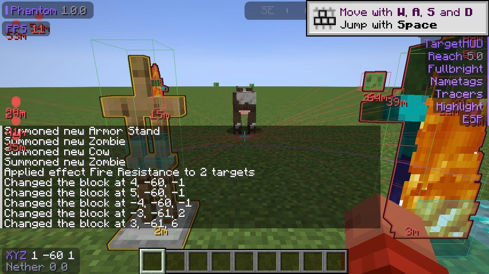
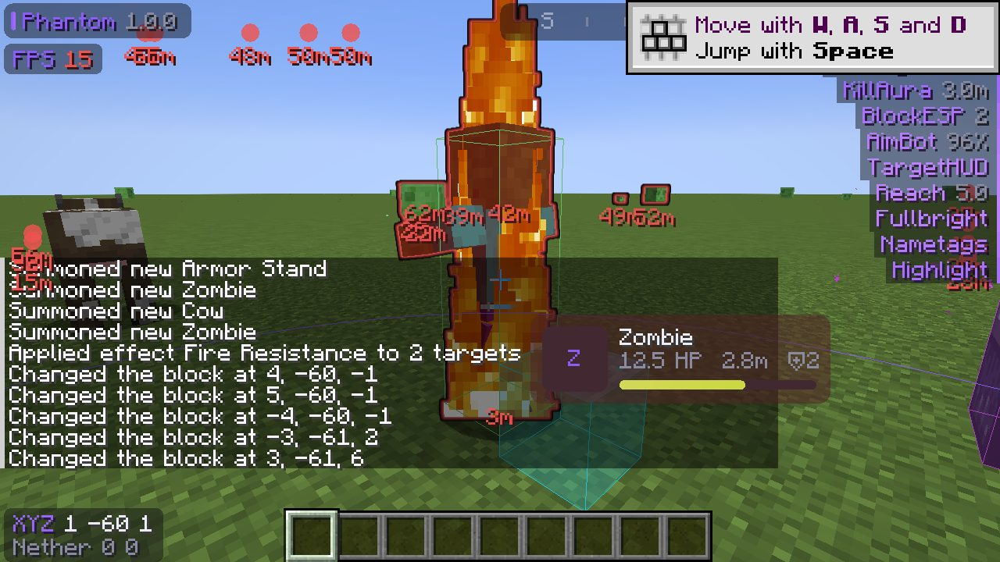
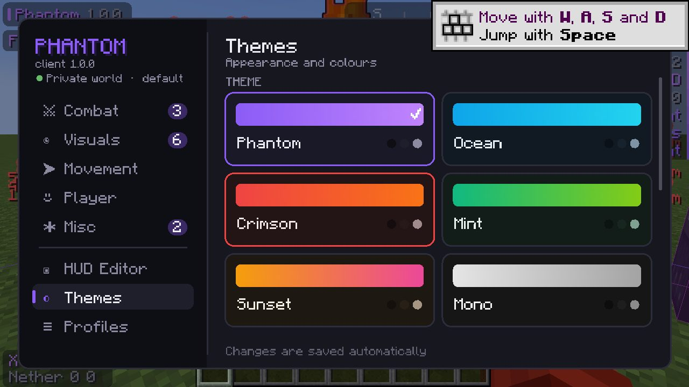
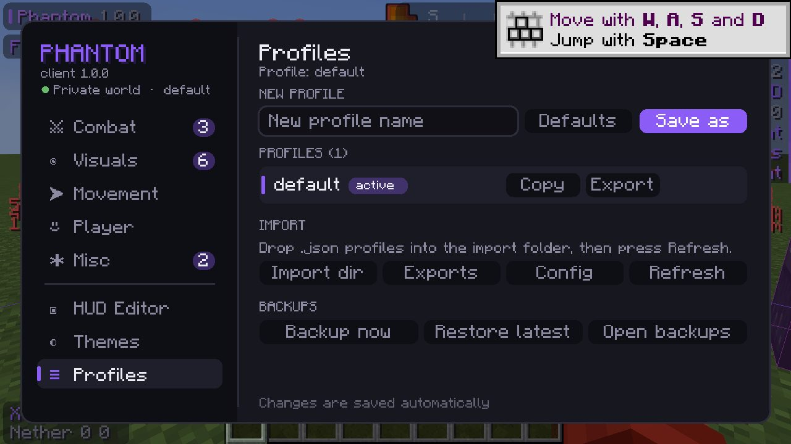
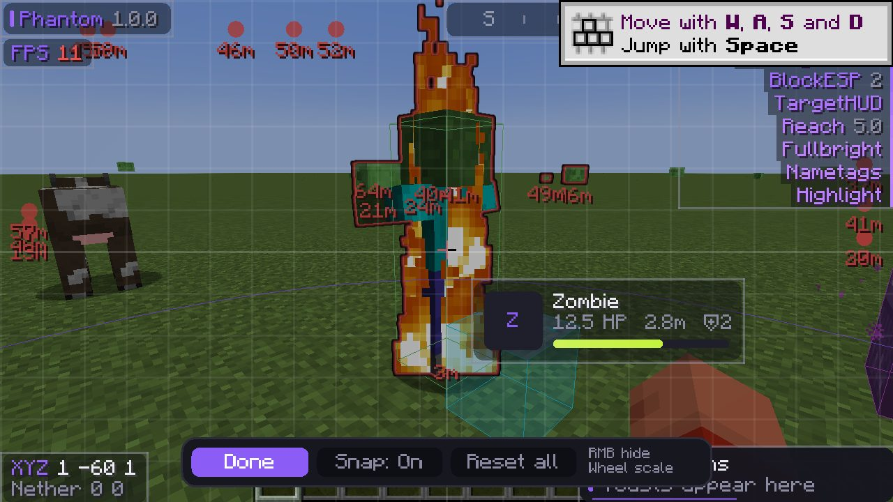

# Testing

| Suite | Command | Covers |
|---|---|---|
| Java unit tests (11) | `./gradlew :PhantomCore:test` | event bus subscription lifecycle, private-world guard, settings clamping/validation, search, version compare, config round-trip, malformed input, profile create/switch/export/import/delete, backups, launcher profile hand-off |
| .NET unit tests (16) | `dotnet test PhantomLauncher/tests/PhantomLauncher.Tests` | semver, shared compatibility table, Java release-file parsing, Minecraft process detection from command lines, update evaluation, launcher_profiles.json merge (others preserved, backup written), mod install, Fabric version files, profiles import/export/delete, status heartbeat, log tailing with rotation |
| In-game self-test (16 checks) | `xvfb-run -a ./gradlew :MinecraftIntegration:runSelftest` | real client boot, **every mixin force-applied** (`MixinEnvironment.audit()`), flat creative test world, guard context, all visual modules error-free, StorageESP/BlockESP find planted containers/ores, Fullbright, KillAura hits a dummy and a mob but ignores one 15 m away, Fly grants flight, Freecam detaches and restores the camera, ClickGUI/Themes/Profiles/HUD editor render, config persisted, profile switching |

The self-test is a separate dev-only mod (`MinecraftIntegration/src/selftest`) that is **never shipped**.
It writes `run-selftest/phantom-selftest.json` and screenshots to `run-selftest/screenshots/`.
CI runs all three suites (`.github/workflows/build.yml`).

## Last results

- Java unit tests: 11/11 passed
- .NET launcher-core tests: 16/16 passed
- In-game self-test: 16/16 passed (Minecraft 1.21.1, Fabric Loader 0.16.14, Java 21, Mesa llvmpipe under Xvfb)

## Manual checklist (Windows launcher)

The WPF window can only run on Windows. Before a release, check:

- [ ] `PhantomClient.exe` starts without .NET installed; a second instance shows "already running"
- [ ] Home detects `.minecraft`, versions, Java runtimes and the Minecraft Launcher
- [ ] LAUNCH creates `versions/fabric-loader-0.16.14-1.21.1`, `phantom-instance/mods/phantom-client-1.0.0.jar`, and the "Phantom Client" launcher profile
- [ ] The game starts from the Minecraft Launcher; Home shows the process, then "Connected · profile ..."
- [ ] The console streams the game log; filters and Copy/Clear work
- [ ] Profiles: Use / Duplicate / Import / Export / Delete; the selected profile is active in game
- [ ] Settings persist across restarts; Reset works
- [ ] On a multiplayer server, PRIVATE modules switch off with a toast and the status shows "training modules locked"
