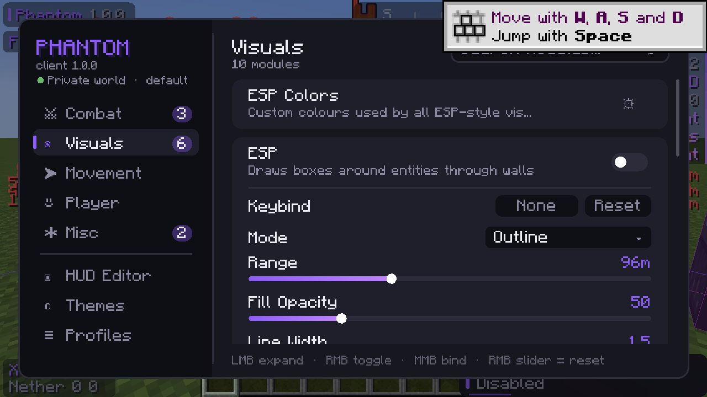

# Phantom Client

A modular client for **Minecraft: Java Edition 1.21.1**, delivered as a Windows launcher
(`PhantomClient.exe`) plus a Fabric mod. It has a modern ClickGUI, a drag-and-drop HUD, JSON
profiles and 26 modules across Combat, Visuals, Movement, Player and Misc.



> **Fair-play by design.** Combat-training modules (KillAura, AimBot, Criticals) and
> movement-testing modules (Fly, Speed, BunnyHop, Spider, NoSlow) only run in a **private
> world**: singleplayer, or a LAN world you host. When you join a remote server they are switched
> off and cannot be enabled. KillAura and AimBot never target players. Phantom has no anti-cheat
> evasion or stealth features, and nothing it does is hidden from servers.

## Highlights

| | |
|---|---|
| **Launcher** | WPF dark UI, Minecraft / Java / process detection, compatibility check, profile selector, live console with the game log, error log, update checker |
| **Integration** | Fabric Loader + Fabric API (rendering, lifecycle) + Mixin. Separate game folder, so your other mods are untouched |
| **ClickGUI** | Right Shift. Animated, rounded, search (just start typing), category sidebar, toggles, sliders, dropdowns, colour pickers, keybind editor, theme selector, profile manager |
| **HUD** | Watermark, FPS, coordinates (+Nether), compass, animated module list, target info, notifications. Drag-and-drop editor with snapping, per-element scale and colours |
| **Config** | JSON profiles, autosave, rolling backups, import/export, per-module settings and keybinds, launcher-selected profile |
| **Performance** | One shared entity scan per tick, 2 draw calls for all 3D shapes, budgeted block scanning, async config IO, modules cost nothing while disabled |

## Quick start (players)

1. Install the official **Minecraft Launcher** and sign in once.
2. Run **`PhantomClient.exe`** and press **LAUNCH**.
3. In the Minecraft Launcher, select **Phantom Client** and press **Play**.
4. In game, press **Right Shift**.

See [Documentation/INSTALLATION.md](Documentation/INSTALLATION.md) for details and troubleshooting.

## Building

| Platform | Command | Produces |
|---|---|---|
| Windows (JDK 21 + .NET 8 SDK) | `.\build.ps1` | `dist\PhantomClient.exe`, `dist\phantom-client-1.0.0.jar` |
| Linux / macOS | `./build.sh` | mod jar + all tests; the exe only if your .NET SDK has the WindowsDesktop SDK |
| CI | `.github/workflows/build.yml` | jar (Ubuntu) → exe (Windows runner) → GitHub release on `v*` tags |

`build.ps1` builds the mod with Gradle, embeds it in the launcher and publishes a single-file,
self-contained `PhantomClient.exe`, so end users need no .NET install.

## Releasing an update

Bump nothing by hand. Tag and push:

```bash
git tag v1.2.0
git push origin v1.2.0
```

GitHub Actions builds the mod and `PhantomClient.exe` with version 1.2.0 taken from the tag, runs all
tests including the in-game self-test, and publishes a release with `PhantomClient.exe`, the mod jar and
`SHA256SUMS.txt`. Every installed launcher picks it up on its next start and updates itself
(see [Updates](Documentation/INSTALLATION.md#updates)).

## Project layout

```
PhantomLauncher/        C# / WPF launcher  -> PhantomClient.exe
  src/PhantomLauncher.Core/   platform-neutral logic (installer, profiles, detection models, logging)
  src/PhantomLauncher/        WPF UI + Windows services (registry, WMI, launcher discovery)
  tests/                      xUnit tests for the core
PhantomCore/            Java: module framework, settings, events, themes, HUD model, IPC
Configuration/          Java: JSON profiles, autosave, backups, import/export (compiled into PhantomCore)
MinecraftIntegration/   Java: Fabric entrypoint, mixins, rendering, input, guard, self-test
Modules/
  Combat/  Visuals/  Movement/  Player/  Misc/
GUI/                    ClickGUI, HUD editor, widgets
HUD/                    HUD manager + elements
Resources/              branding (logo, .ico) and shared compatibility.json
Documentation/          guides (installation, architecture, modules, configuration, compatibility, testing)
```

## Documentation

- [Installation guide](Documentation/INSTALLATION.md)
- [Version compatibility](Documentation/VERSION_COMPATIBILITY.md)
- [Architecture](Documentation/ARCHITECTURE.md)
- [Modules](Documentation/MODULES.md)
- [Configuration & profiles](Documentation/CONFIGURATION.md)
- [Testing](Documentation/TESTING.md)

## License

MIT. Minecraft is a trademark of Mojang Studios; Phantom Client is not affiliated with Mojang or Microsoft.
